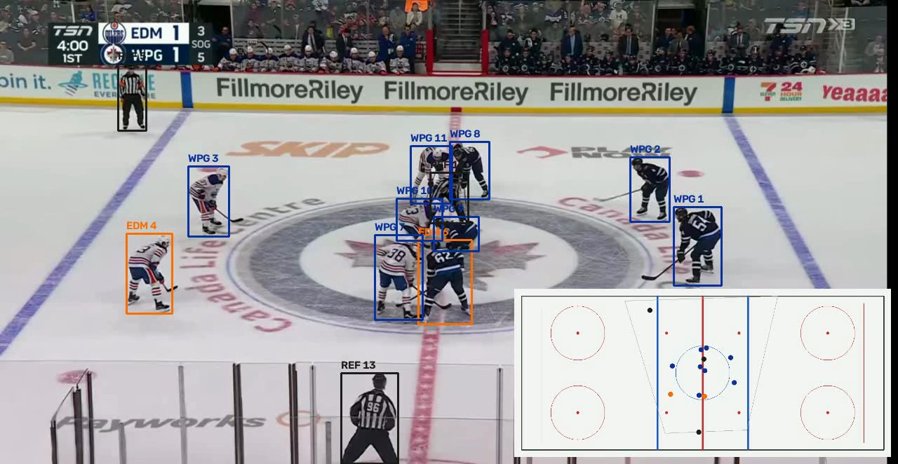
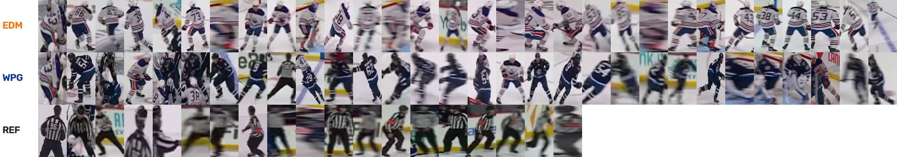
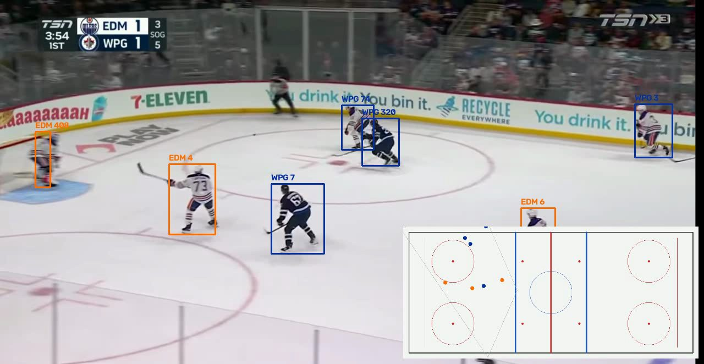
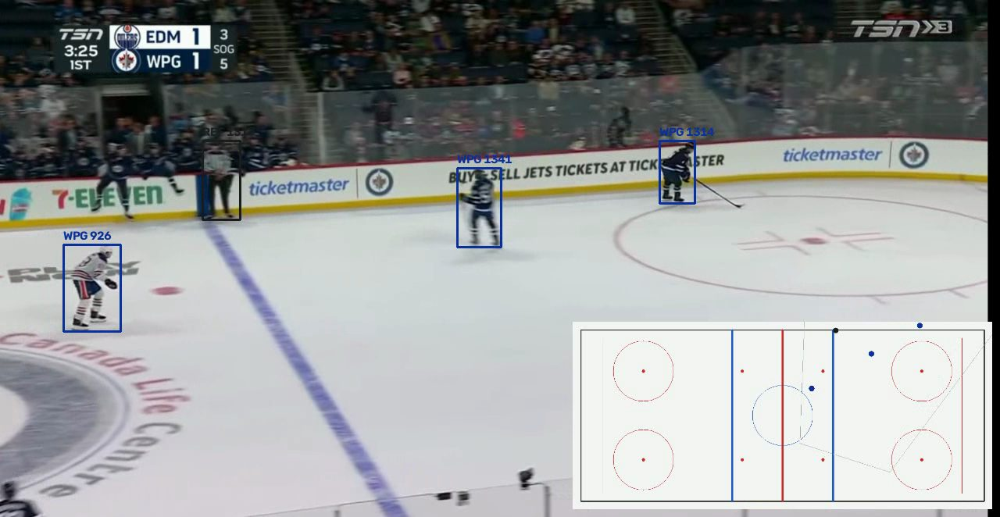
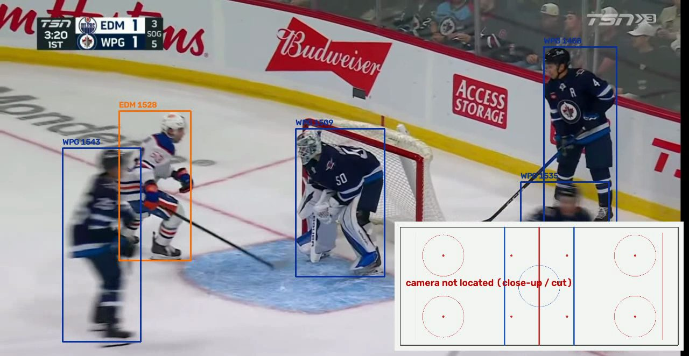

# Hockey broadcast analysis

A small computer vision project on a 67-second clip of an NHL pre-season game (Edmonton Oilers at
Winnipeg Jets, TSN broadcast). The pipeline finds the players on the ice, follows them from frame to frame,
tells the two teams and the referees apart by jersey colour, and draws every player on a top-down rink.



The video itself is not in the repository (it is broadcast footage). Any wide-angle hockey clip works: put it
in `data/` and adjust the four reference points in `hockey/rink.py` (see step 4).

## Pipeline

| Step | File | What it does |
|---|---|---|
| 1. Detection and tracking | `hockey/track.py` | YOLO11m (COCO, class "person") on every second frame, ByteTrack for identities, an ice mask to drop spectators and bench |
| 2. Team assignment | `hockey/teams.py` | Colour statistics of the jersey area, rules for EDM / WPG / referee, majority vote over each track |
| 3. Drawing | `hockey/render.py` | Boxes coloured by team, and a contact sheet of crops for checking the team split |
| 4. Top-down rink | `hockey/rink.py` | Homography from image to rink, chained over frames with ORB + RANSAC, cut detection, relocalization and drift correction |

```bash
uv sync
uv run python -m hockey.track data/clip.mov
uv run python -m hockey.teams
uv run python -m hockey.render
uv run python -m hockey.rink
```

Outputs go to `runs/`: `tracks.pkl`, `teams.json`, `teams_sheet.jpg`, `tracked.mp4` and `minimap.mp4`.

### 1. Detection, tracking and the ice mask

YOLO11m finds 12 to 19 people per frame, but a third of them are fans, the bench or people behind the
glass. A person is kept only if the point under their skates lies on the ice. The ice is found as bright,
unsaturated pixels (`S < 50`, `V > 160`). The painted lines, the centre logo and the players cut that area
into pieces, so the mask is the convex hull of the large white pieces. The white boards stay out because
the coloured kick plate separates them from the ice and the strip they form is thin.

### 2. Teams

The first attempt embedded each player crop with an ImageNet ResNet-18 and clustered the embeddings with
k-means. The clusters followed pose, motion blur and background instead of jerseys, so that approach was
dropped. Colour turned out to be enough. For the middle of the jersey four numbers are measured: the share
of dark pixels, the share of white pixels, and the saturation and blueness (B − R) of the dark pixels.

* Referees: some dark, and the dark is grey-black (low saturation, not blue).
* Winnipeg: mostly dark navy.
* Edmonton: mostly white.

Each frame of a track is classified and the track takes the majority label, which absorbs frames where
another player overlaps the box.



### 3–4. From the image to the rink

The ice is a plane, so the mapping from image to rink is a homography. On the first frame it is computed
from four points with known rink coordinates: the neutral-zone faceoff dots at (±20, ±22) ft. After that:

* **Chaining.** ORB features on the ice (players and broadcast graphics masked out) are matched to the
  previous frame and a homography is fitted with RANSAC, so `H_rink←k = H_rink←k−1 · H_k−1←k`.
* **Cuts.** A sharp change of the colour histogram, or too few inliers, means a cut to another camera
  (close-ups, replays). The chain is dropped and the rink view says that the camera is not located.
* **Relocalization.** While lost, each frame is matched against a bank of earlier keyframes with known
  homographies. With 80 or more RANSAC inliers the camera is placed again.
* **Drift correction.** Chaining accumulates error during long pans. Every 10 frames the current frame is
  also matched against keyframes from the opening seconds; a strong match replaces the chained estimate.

| Left zone | Right zone |
|---|---|
|  |  |

When the broadcast cuts to a close-up, the rink view is switched off instead of showing wrong positions:



## Results and limitations

* Out of 1880 processed frames, the camera is placed on the rink in 1527 (81%). The rest are close-ups,
  replays and a few blurred pans that were not recovered.
* In the defensive zones far from centre ice the drift correction has nothing to match, so positions there
  can be off by several metres until the play comes back to the neutral zone.
* Team labels are right for most tracks. The errors are mostly at faceoffs and scrums, where one box covers
  two players from different teams.
* ByteTrack loses identities when players overlap or the camera cuts, so one player gets several track IDs
  over the clip. Re-identification by jersey number would fix that and is the next thing to add.
* The four reference points and the colour thresholds are set for this clip. Another arena or other
  jerseys need new values.

## Course topics used

Object detection with a pretrained CNN, multi-object tracking, colour spaces and segmentation by
thresholding, connected components and convex hulls, ORB features, homographies, RANSAC, and the
limits of transfer learning from ImageNet features.
